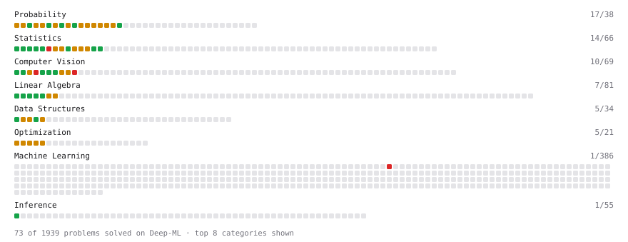

# Deep-ML

My machine learning practice from [Deep-ML](https://www.deep-ml.com). Every solution here was written by hand.

**6** solved · 0 problems · 6 labs · 0 math

[**Browse the interactive portfolio**](https://arunshar.github.io/deep-ml/) to replay this filling in over time.

## Labs

| | Difficulty | Solved | |
| --- | --- | --- | --- |
| [PyTorch: Build a Complete Training Loop](https://www.deep-ml.com/labs/13) | easy | 2026-02-03 | [solution](labs/0013-pytorch-build-a-complete-training-loop) |
| [MNIST: Design Your Own Pytorch Optimizer](https://www.deep-ml.com/labs/3) | medium | 2026-01-25 | [solution](labs/0003-mnist-design-your-own-pytorch-optimizer) |
| [MNIST: Design-Your-Own tiny Pytorch Model](https://www.deep-ml.com/labs/2) | medium | 2026-01-25 | [solution](labs/0002-mnist-design-your-own-tiny-pytorch-model) |
| [MNIST: Pytorch DataLoader](https://www.deep-ml.com/labs/1) | medium | 2026-01-23 | [solution](labs/0001-mnist-pytorch-dataloader) |
| [MNIST: Adversarial Example Generation](https://www.deep-ml.com/labs/5) | hard | 2026-02-03 | [solution](labs/0005-mnist-adversarial-example-generation) |
| [MNIST: Classification Loss (with Gradient)](https://www.deep-ml.com/labs/4) | hard | 2026-01-27 | [solution](labs/0004-mnist-classification-loss-with-gradient) |

---

_This file is regenerated by Deep-ML on every push._
